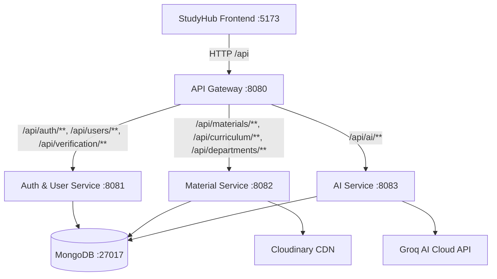

# StudyHub Microservices Architecture

This project is a decoupled microservices architecture for the StudyHub academic sharing platform, migrating from the monolithic `studyhub-backend`.

## System Architecture



## Microservices Modules

| Service | Port | Responsibilities | Key Technologies |
|---|---|---|---|
| **`studyhub-common`** | Shared Library | Shared JWT provider, filters, exception models, ApiResponse DTOs | Spring Security, JJWT |
| **`studyhub-gateway`** | `8080` | Unified API entry point, route forwarding, global CORS | Spring Cloud Gateway (WebFlux) |
| **`auth-service`** | `8085` | User registration, login, OTP email verification, user management, admin approvals | Spring Boot, Spring Security, MongoDB, JavaMail |
| **`material-service`** | `8082` | Study materials, syllabus, curriculums, departments, subjects, file uploads | Spring Boot, Spring Data MongoDB, Cloudinary |
| **`ai-service`** | `8083` | AI material summaries, reactive chat streaming with Groq, chat histories | Spring Boot, Spring WebFlux, Reactive Streams, Groq |

## Routing Matrix

| Frontend API Route | Target Microservice | Internal Port |
|---|---|---|
| `/api/auth/**` | `auth-service` | `8085` |
| `/api/users/**` | `auth-service` | `8085` |
| `/api/verification/**` | `auth-service` | `8085` |
| `/api/admin/users/**` | `auth-service` | `8085` |
| `/api/admin/teachers/**` | `auth-service` | `8085` |
| `/api/admin/stats` | `auth-service` | `8085` |
| `/api/admin/activity` | `auth-service` | `8085` |
| `/api/materials/**` | `material-service` | `8082` |
| `/api/curriculum/**` | `material-service` | `8082` |
| `/api/departments/**` | `material-service` | `8082` |
| `/api/admin/materials/**` | `material-service` | `8082` |
| `/api/ai/**` | `ai-service` | `8083` |

## How to Run

### Option 1: Run with Docker Compose
```bash
docker-compose up --build
```

### Option 2: Run locally using Maven & PowerShell
1. Start MongoDB on localhost:27017:
```bash
mongod
```
2. Build all modules:
```powershell
.\build-all.ps1
```
3. Run services:
```powershell
.\start-microservices.ps1
```
4. Start the frontend:
```bash
cd studyhub-frontend
npm run dev
```
Frontend accesses the API Gateway seamlessly at `http://localhost:8080/api`.
